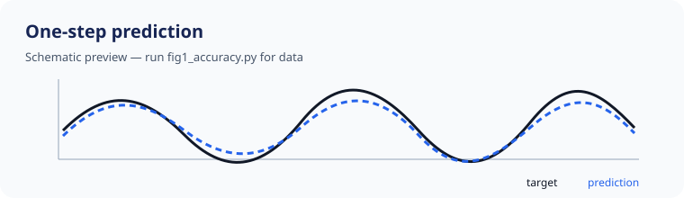
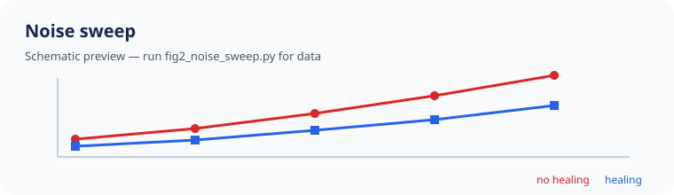
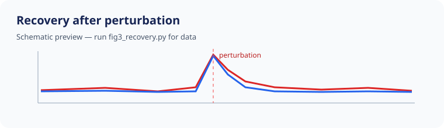
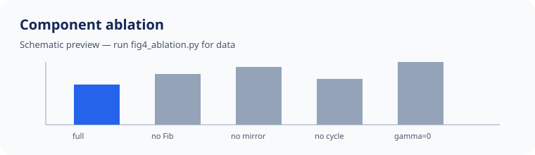
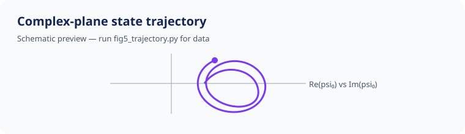

# FD-PRC — Fibonacci-Dissipative Physical Reservoir Computing

A small NumPy implementation of a **Fibonacci-modulated reservoir**, optional state-healing layer, and linear readouts. The repository includes six scripts for generating prediction, noise, recovery, ablation, trajectory, and readout-comparison plots.

> **Scope note:** FD-PRC is currently a numerical toy model implemented with NumPy. Its state is a normalized complex vector; it does not simulate a quantum device or implement a full Lindblad/open-quantum-system solver. The experiment plots are generated by the scripts in `scripts/` and should be treated as results of this implementation, not as evidence of general physical or hardware performance.

## At a glance

- Input modulation uses cached Fibonacci numbers to set the injection amplitude and phase.
- The reservoir updates a complex state through input injection, a component-wise nonlinear map, mirror operation, scalar decay, optional healing, and normalization.
- Each timestep exposes amplitude, phase, and power features to a readout.
- Available readouts include ridge regression, a one-pass Hebbian update, and a randomly initialized zero-shot baseline.
- No neural-network backpropagation is used in the included reservoir/readout implementations.

## Model and implementation

`FDReservoir` defaults to 8 groups with dimension 4 (32 complex state elements). The observable vector concatenates `abs(psi)`, `angle(psi)`, and `abs(psi)**2`, producing 96 features with the default configuration.

At timestep `t`, the implementation performs these operations in order:

1. **Fibonacci-modulated input:** select `(F[t+1], F[t])` from a fixed cache (indices saturate at the end of the cache); use it to scale and phase a seeded random input pattern.
2. **Nonlinear map:** apply `exp(a*dt + 1j*beta*psi*dt)` element-wise.
3. **Mirror:** apply `2*mu - conj(psi)`.
4. **Decay and normalization:** multiply by `exp(-gamma*dt)` and normalize the vector.
5. **Optional healing:** move the state toward the initial reference state using a Fibonacci-ratio-scaled correction, then normalize again.
6. **Features:** return amplitude, phase, and power values.

The implementation normalizes the state after the scalar decay. Consequently, for a nonzero state, that scalar factor is canceled by normalization; `gamma` should not be interpreted as a full physical dissipative evolution. Likewise, the `limit_cycle` method is the specific component-wise map above, not a general proof of a limit-cycle attractor.

`HealingLayer` retains a copy of the initial state as its reference. `IDENTITY_HEAL` disables healing. The ablation script also supplies `FDNoFib`, `FDNoMirror`, `FDNoLimitCycle`, and a zero-`gamma` reservoir.

## Repository layout

```text
src/fdprc/       Reservoir, healing, data, configuration, and readout implementations
scripts/         Six figure scripts, an all-figures runner, and physics checks
tests/           Physics/invariant tests
docs/figures/    Explanatory SVG previews embedded below; numeric PNGs are generated here
```

## Installation

Requires Python 3.10 or later.

```bash
git clone https://github.com/synthesis496/FD-PRC.git
cd FD-PRC
python -m venv .venv
# Activate the virtual environment, then:
python -m pip install --upgrade pip
python -m pip install -e '.[dev]'
```

The runtime dependencies are NumPy and Matplotlib. The `dev` extra installs pytest.

## Quick start

```python
from fdprc import FDReservoir, HealingLayer, sine_signal, collect
from fdprc import ridge_fit, ridge_predict, rmse

signal = sine_signal(T=2000, noise=0.05, seed=0)
reservoir = FDReservoir()
healing = HealingLayer(reservoir.psi)
features = collect(reservoir, signal, heal=healing)

n_train = int(0.7 * len(signal))
weights = ridge_fit(features[:n_train - 1], signal[1:n_train])
prediction = ridge_predict(features[n_train:-1], weights)
print('test RMSE:', rmse(signal[n_train + 1:], prediction))
```

`sine_signal` creates `sin(t) + 0.3*sin(2.7*t)` with optional seeded Gaussian noise. `collect` feeds the sequence into the reservoir and returns one feature row per input sample.

## Experiments and figures

The SVGs below are **explanatory previews, not measured experimental output**. To reproduce the actual plots defined in the figure scripts, run:

```bash
python scripts/run_all.py
```

This runs `fig1_accuracy.py` through `fig6_readout_compare.py` and writes six PNG files to `docs/figures/` (overwriting same-named PNGs if present). The experiments use a synthetic noisy sine signal and fixed defaults/seeds as defined in their scripts.

| Script | What it evaluates |
| --- | --- |
| `fig1_accuracy.py` | One-step signal prediction and test RMSE / R² |
| `fig2_noise_sweep.py` | Test RMSE over several noise levels, with and without healing, across five seeds |
| `fig3_recovery.py` | Prediction error around a single large input perturbation |
| `fig4_ablation.py` | Test RMSE after removing or disabling selected reservoir components |
| `fig5_trajectory.py` | Complex-plane trajectory of the first state component |
| `fig6_readout_compare.py` | Ridge, one-pass Hebbian, and random zero-shot readout RMSE comparison |

### Figure previews

**1. One-step prediction** — the script plots the held-out target and model prediction.



**2. Noise sweep** — the script compares mean test error and standard deviation across seeds.



**3. Perturbation recovery** — the script compares absolute prediction errors and marks the perturbation timestep.



**4. Component ablation** — the script compares test RMSE for the full reservoir and ablated variants.



**5. State trajectory** — the script plots the real and imaginary parts of the first complex state component.



**6. Readout comparison** — the script compares test RMSE for the three implemented readout approaches.


Run the tests with:

```bash
pytest
```

## Configuration

`fdprc.config` provides immutable dataclasses and builders. The defaults are 8 qudits, `d=4`, `gamma=0.15`, `a=-0.05`, `beta=0.4`, `mu=0`, reservoir seed 42, healing `gamma_heal=0.08`, `p=0.5`, `e_omni=1.0`, ridge `alpha=1e-6`, and a 2,000-sample dataset with noise 0.05 and a 70% training split. These are software parameters; names such as `qudits` do not imply a hardware implementation.

## License

See [`LICENSE`](LICENSE) for the repository license. Note that `pyproject.toml` currently declares a different license identifier from the checked-in license file; resolve that metadata mismatch before redistributing the package.
